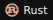
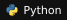
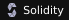
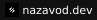
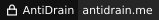

 
     
    

Support the work

| Network | Address |
| --- | --- |
| EVM chains | `0xDEADf12DE9A24b47Da0a43E1bA70B8972F5296F2` |
| SOL | `DEVVnq8UA1DwqsyMSn6aABj7VFmQYfi2bhfFCBX1j4dn` |
| TRX | `TDEVVjmJidBatqdCxvgtfSHLMJWGpgwYgd` |

